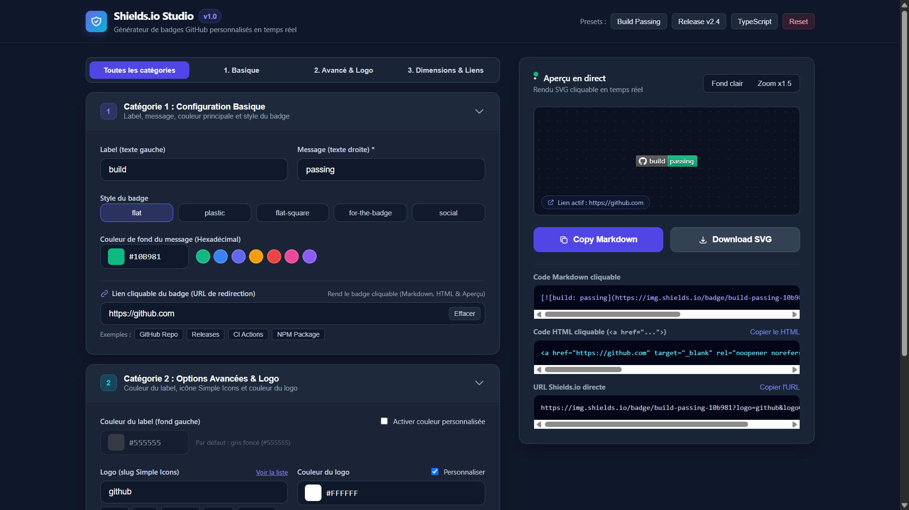

<div align="center">

# 🛡️ Shields.io Studio

### Générateur interactif de badges GitHub personnalisés en temps réel

[](https://shields.io/)
[](https://github.com)
[](https://developer.mozilla.org/)

<p align="center">
  Un studio web léger, rapide et sans dépendances pour concevoir, prévisualiser et exporter vos badges et bannières <strong>Shields.io</strong> en <strong>Markdown</strong>, <strong>HTML</strong> et <strong>SVG</strong> sans jamais recharger la page ni mémoriser la syntaxe d'encodage d'URL.
</p>

---



</div>

---

Ce projet a été **semi vibe-codé** par **LiL PouLaY** 

---

## 🚀 Fonctionnalités principales

### 1. Configuration Basique & Styles
- **Label & Message en direct** : encodage automatique des caractères spéciaux Shields.io (`-` → `--`, `_` → `__`, espaces, `#`, `?`, `%`, `/`).
- **5 styles officiels** accessibles en un clic : `flat`, `plastic`, `flat-square`, `for-the-badge` et `social`.
- **Sélecteur de couleur & Nuancier rapide** : synchronisation bidirectionnelle entre le color picker visuel, le champ hexadécimal (`#RRGGBB`) et une palette de presets (*Emerald, Blue, Indigo, Amber, Red, Pink, Violet*).
- **Liens cliquables prêts à l'emploi** : configurez l'URL de redirection avec des puces rapides (*GitHub Repo, Releases, CI Actions, NPM Package*).

### 2. Options Avancées & Logos Simple Icons
- **Couleur personnalisée du label** (`labelColor`) activable à la demande pour créer des contrastes sur mesure.
- **Intégration Simple Icons** : ajout instantané de n'importe quel slug d'icône (`github`, `react`, `typescript`, `docker`, `nodedotjs`, `rust`, etc.) avec personnalisation de la teinte du logo (`logoColor`).

### 3. Dimensions & Comportement du Lien
- **Taille adaptative du logo** : support de l'option `logoSize=auto`.
- **Lien SVG natif** (`?link=...`) et contrôle de l'ouverture dans un nouvel onglet HTML (`target="_blank" rel="noopener noreferrer"`).

### 4. Studio d'Aperçu & Exports Instantanés
- **Canvas interactif** : bascule **Fond sombre / Fond clair** (damier de transparence) et **Zoom x1.5** pour inspecter chaque pixel.
- **Presets intégrés** : chargez des configurations types (*Build Passing*, *Release v2.4*, *TypeScript*) ou réinitialisez en un clic.
- **Exports en 1 clic** :
  - 📋 **Copy Markdown** : génère le code `[](targetUrl)` avec notification toast.
  - 💻 **Copier le HTML** : génère la balise `<a href="..."></a>` accessible et dimensionnée.
  - 🔗 **Copier l'URL directe** : l'URL brute `https://img.shields.io/badge/...`.
  - ⬇️ **Download SVG** : récupère et télécharge directement le fichier vectoriel `.svg` nommé proprement.

---

## 🎨 Galerie d'exemples de Banners & Badges Shields.io

Voici des exemples de bannières et de badges que vous pouvez recréer directement dans **Shields.io Studio** pour habiller vos propres `README.md` :

### 🏆 Bannières « For-The-Badge » (Idéal en en-tête de README)

| Rendu visuel | Code Markdown à copier |
| :--- | :--- |
|  | `` |
|  | `` |
|  | `` |
|  | `` |

### 💻 Badges de Stack Technique (`flat-square` & `flat`)

```markdown


```

**Rendu :**


### 🔍 Comparatif des 5 styles supportés

| Style | Aperçu | Paramètre |
| :--- | :---: | :--- |
| **Flat** *(par défaut)* |  | `style=flat` |
| **Flat-Square** |  | `style=flat-square` |
| **Plastic** |  | `style=plastic` |
| **For-The-Badge** |  | `style=for-the-badge` |
| **Social** |  | `style=social` |

---

## 🛠️ Utilisation

Shields.io Studio est directement disponible en ligne. Accédez au studio interactif via le lien suivant :  
🌐 **[https://shieldsiostudio.netlify.app](https://shieldsiostudio.netlify.app)**

---


<div align="center">

**Shields.io Studio** • Conçu par **LiL PouLaY**  
*Semi Vibe-Coded avec soin • Formats supportés : SVG • Markdown • HTML*


</div>
